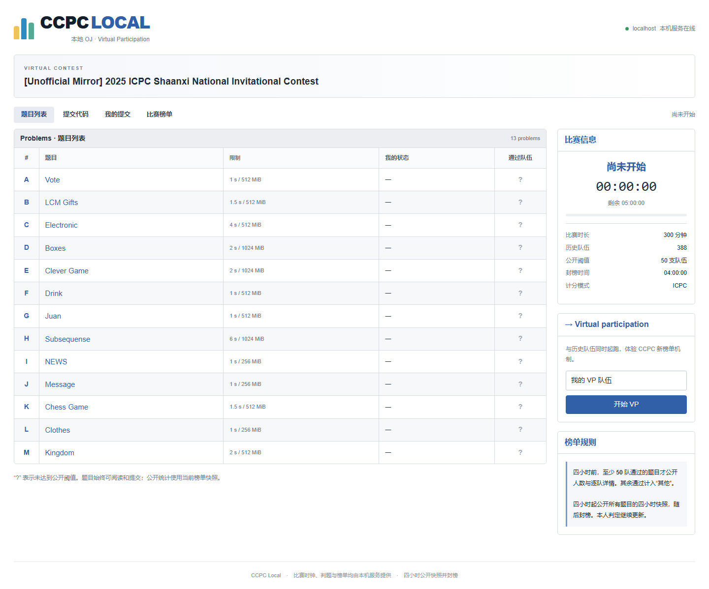
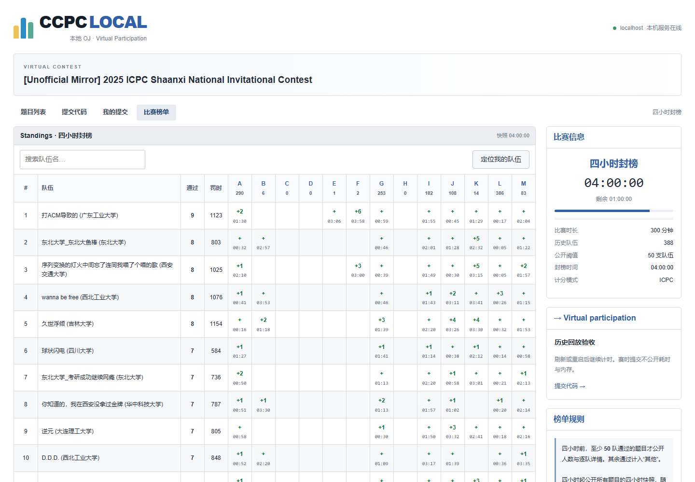

# 验收报告

验收日期：2026-10-04。平台：Windows-11-10.0.22621-SP0；Python 3.12.5；GCC 15.2.0，PowerShell 7.6.1，Chromium 145 / Playwright 1.58.0。

结论：本地 OJ 的启动、数据导入、历史回放、真实判题、四类页面、阈值隐藏、四小时封榜、赛后结果及会话恢复已实现，并通过下列 Windows 实测。原题包与历史文件没有为通过验收而改写。

## 交付入口

```powershell
python launcher.py --problem-list tests/ICPC-Shaanxi-2025-National-Invitational-Contest --submissions tests/contest.txt
```

也可使用 `pwsh launcher.ps1 -ProblemList ... -Submissions ...`。服务就绪后打开浏览器，网页中点击 VP。依赖准备、可选参数、日志与 API 见 [README](../README.md)。

## 自动化与数据验收

- 30 项规则 / 导入 / API / 持久化 / 资源测试全部通过，0 失败、0 错误、0 跳过。[原始日志](acceptance/unit-tests.log)、[JSON](acceptance/unit-results.json)。
- 正确解析 13 题、388 队、3537 条历史事件；完整导入 352 组输入与答案。186 条结束时或之后事件保留，但不计分。
- 全部 13 题主标程在全部导出数据上 AC；每题一个真实错解正确拒绝。使用原 testlib checker；[结果明细](acceptance/judge-results.json)。
- CE、TLE、RE、MLE、OLE、Judge Error 六类受控探针均得到预期判定。
- Python 3 提交 L 题参考解通过 38/38 case，语法错误映射 CE；[Python 结果](acceptance/python-results.json)。
- 13 道题的独立 C++ 参考解按 `checkWith`、`cases` / `groups` 的适用范围通过，H / K 不强行运行超出范围的大数据；[参考解结果](acceptance/reference-results.json)。
- 两次内容摘要一致，证明判题未改写题包；摘要在 judge-results 中。会话恢复与输入变化隔离均由自动化测试覆盖。

| 题目 | 主标程 | 错解 |
| --- | --- | --- |
| A | 30/30 AC | WA（正确拒绝） |
| B | 33/33 AC | WA（正确拒绝） |
| C | 30/30 AC | WA（正确拒绝） |
| D | 13/13 AC | WA（正确拒绝） |
| E | 30/30 AC | WA（正确拒绝） |
| F | 30/30 AC | WA（正确拒绝） |
| G | 30/30 AC | WA（正确拒绝） |
| H | 12/12 AC | WA（正确拒绝） |
| I | 22/22 AC | WA（正确拒绝） |
| J | 22/22 AC | WA（正确拒绝） |
| K | 32/32 AC | WA（正确拒绝） |
| L | 38/38 AC | WA（正确拒绝） |
| M | 30/30 AC | WA（正确拒绝） |

## 浏览器与阶段验收

- 真实启动器 → VP → 读题 → 精确复制样例 → 上传 L 题源码 → 38 组数据 AC → 刷新恢复 → 榜单显示“其他1题”的完整流程通过。
- E / G / H / L 多样例格式由数据测试覆盖；浏览器实测 L 五组样例，D / I 相对配图与 LaTeX 正常。
- 赛时返回数据不含提交耗时 / 内存，隐藏题的逐队格子不在公共响应中。
- 桌面 1440px 和手机 390px 布局无页面横向溢出；榜单搜索在轮询后保持焦点；控制台无错误，只发起 loopback 请求，未使用联网 CDN。
- 注入服务端测试时钟，以真实历史事件验证两小时公开 A/G/L、四小时公开全部题目并冻结、四小时后提交控件可用、五小时结束及显式最终结果。未伪造判定，未添加生产调时接口。
- 重新 VP 和旧会话选择器可用。两小时 / 四小时 / 最终榜单截图明确属于可控时钟验收，时间不是等待真实五小时得到的。

[浏览器结果](acceptance/browser-results.json) · [阶段结果](acceptance/phase-results.json)





更多截图：[题目与样例](acceptance/02-problem-desktop.png)、[真实 AC](acceptance/03-submission-desktop.png)、[隐藏榜单](acceptance/04-board-desktop.png)、[手机首页](acceptance/05-home-mobile.png)、[手机榜单](acceptance/06-board-mobile.png)、[两小时](acceptance/07-two-hour-home.png)、[最终结果](acceptance/09-final-board.png)。

## 启动与进程验收

普通 `python launcher.py` 自动回退虚拟环境、路径含空格、端口占用自动换端口、无效端口 / 缺输入 / 缺编译器诊断均通过；Ctrl+C / SIGBREAK 正常清理且退出码为 0。[启动结果](acceptance/launcher-results.json)。

后台判题不阻塞 HTTP；超时、取消、根进程退出后仍有子进程的清理均经过真实进程测试。Windows Store Python 的派生代理也纳入跟踪和退出等待。

## 复现与实际限制

```powershell
.\.venv\Scripts\python.exe scripts/unit_acceptance.py
.\.venv\Scripts\python.exe scripts/acceptance.py
.\.venv\Scripts\python.exe scripts/python_acceptance.py
.\.venv\Scripts\python.exe scripts/reference_acceptance.py
.\.venv\Scripts\python.exe scripts/browser_acceptance.py
.\.venv\Scripts\python.exe scripts/phase_acceptance.py
.\.venv\Scripts\python.exe scripts/launcher_acceptance.py
.\.venv\Scripts\python.exe scripts/package_acceptance.py
```

Linux / macOS 提供路径、启动与进程组适配，未在这些平台实测。资源限制使用本机计时和采样，精度随 OS、调度和硬件变化。评测源码以当前用户权限运行，未建立面向不可信代码的系统沙箱。首版仅支持非交互题；交互题导入明确拒绝。源码、日志与状态保存在本机，长期使用需要自行归档日志。
