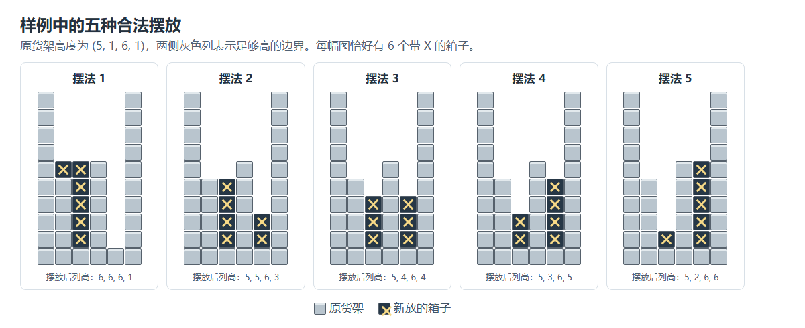

# D. boxes

## 题目描述

小鹏管理着 $n$ 个紧挨着的货架，从左到右第 $i$ 个货架的高度为 $a_i$。在两侧各有一堵无限高的墙，即 $a_0=a_{n+1}=+\infty$。他要在货架上方摆放恰好 $m$ 个单位大小的箱子。

把第 $x$ 列、第 $y$ 层记为坐标 $(x,y)$，其中 $1\le x\le n$、$y$ 为正整数。一个摆放方案合法，当且仅当每个箱子 $(x,y)$ 同时满足：

- 它位于原货架上方，即 $a_x<y$；
- 正下方 $(x,y-1)$ 是原货架的一部分或也放有箱子；
- 左侧 $(x-1,y)$ 是原货架（或左墙）的一部分或也放有箱子；
- 右侧 $(x+1,y)$ 是原货架（或右墙）的一部分或也放有箱子。

不同的方案由所放箱子的坐标集合区分。求合法方案数，答案对 $10^9+7$ 取模。

## 输入格式

第一行包含两个整数 $n,m$，分别表示货架和箱子的数量，满足 $1\le n\le 10^3$、$1\le m\le 10^4$。

第二行包含 $n$ 个整数 $a_1,\ldots,a_n$，满足 $0\le a_i\le 10^5$。

## 输出格式

输出一个整数，表示合法摆放方案数对 $10^9+7$ 取模的结果。

## 样例

```input1
4 6
5 1 6 1
```

```output1
5
```

## 样例说明

下图展示全部五种合法摆法。灰格表示原货架或两侧墙体，深色 X 格表示新放的箱子。配图由 HTML 重绘生成。


