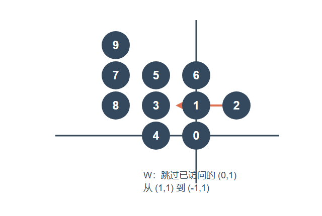

# I. news

小明操纵一架飞机，起点是二维整数坐标平面的 $(0,0)$，该点起初已访问。他要执行 $n$ 次飞行指令。

给定字符串 $P$，它恰好由 `N`、`E`、`W`、`S` 各一个字符组成。第 $i$ 次指令为 $P$ 中第 $((i-1)\bmod 4)+1$ 个字符。

- `N` 表示向上，`E` 表示向右，`W` 表示向左，`S` 表示向下。
- 执行指令时，飞机沿对应方向逐格前进，跳过所有已经访问过的格点，最终停在该方向上第一个**未访问**的格点，并将它标记为已访问。

执行全部 $n$ 次指令后，输出最终位置的横纵坐标之和。

下图说明一次向西飞行：飞机从 $(1,1)$ 出发，$(0,1)$ 已访问，因此继续飞到 $(-1,1)$。



## 输入格式

第一行一个整数 $T$，表示测试用例数。接下来 $T$ 行，每行一个整数 $n$ 和一个长度为 $4$ 的字符串 $P$。

保证 $1\le T\le 10^5$，$1\le n\le 10^9$。$P$ 是 `NEWS` 的一个排列。

## 输出格式

对每组测试，输出一行一个整数，表示最终位置两坐标之和。

## 样例

```input1
6
9 NEWS
9 NESW
9 NSEW
1000000000 SEWN
1000000000 SWNE
1000000000 SNWE
```

```output1
1
-1
-3
-499999999
250000000
500000000
```
